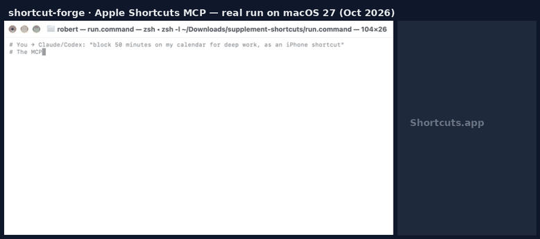

<!-- mcp-name: io.github.Hyunki6040/shortcut-forge -->
<p align="center">
  
</p>

<h1 align="center">shortcut-forge: 아이폰에서 진짜로 돌아가는 단축어를 만드는 Apple Shortcuts MCP</h1>

<p align="center">
  <b>Claude·Codex·ChatGPT에게 말하면 → 서명된 <code>.shortcut</code> 파일 → 아이폰에서 탭 한 번.</b><br>
  Apple Shortcuts MCP · iOS 단축어 생성기 · AI 에이전트용 Siri 단축어 · iOS 27 대응 · Mac 자동 서명 · 오픈 단축어 라이브러리
</p>

<p align="center">
  <a href="README.md">English</a> ·
  <a href="README.ko.md">한국어</a> ·
  <a href="README.ja.md">日本語</a> ·
  <a href="README.zh-CN.md">简体中文</a>
</p>

<p align="center">
  
</p>

---

## 이런 말, 해 본 적 있나요

> *"ChatGPT한테 단축어 만들어 달랬더니 손으로 하나씩 넣으라는 단계 열네 개가 나왔다."*
>
> *"파일은 잘 들어갔는데, 실행하니까 **'이 동작의 각 매개변수에 대한 값을 선택하십시오.'**"*
>
> *"iOS 27에서 설명만 하면 단축어를 만들어 준다는데, 아이폰 15 Pro 이상에서만 되고 한 번에 하나씩, 뭘 바꿨는지
> 리뷰하거나 버전 관리할 방법이 없다."*
>
> *"단축어 MCP를 찾아보면 전부 **이미 있는 단축어를 실행**만 해 준다."*
>
> *"가족용 단축어를 고칠 때마다 다들 다시 내려받아야 한다."*

단축어는 아이폰에서 가장 강력한 자동화 도구인데, AI에게 시키기는 여전히 가장 어렵습니다. 파일 형식은 문서화돼
있지 않고, 구조상 멀쩡한 plist도 기기에서는 깨지며, 폰에 오류가 뜨기 전까지는 아무도 그 차이를 잡아 주지 않습니다.

## 해결

**shortcut-forge**는 MCP 서버이자 Claude 플러그인이자 Python 라이브러리입니다. *"이런 단축어 만들어 줘"*를
**실제 아이폰에서 단축어가 깨지는 방식들로 검사를 통과한, 서명된 `.shortcut` 파일**로 바꿉니다.

```text
나:      "영양제 먹을 때마다 건강 앱에 기록하고, 오늘 미리알림은 완료, 내일 것은 만들어 줘. 중복은 절대 안 되게."
Claude:  → shortcut_library("supplements") → shortcut_from_template("supplement-tracker", …)
         ✓ 동작 750개 · 린트 오류 0 · Mac에서 서명 완료
         → ~/Downloads/shortcut-forge/Supplement Check.shortcut   (AirDrop / iCloud Drive → 탭 → 추가)
```

| | Apple "단축어 설명하기" (iOS 27) | 챗봇에게 물어보기 | 다른 단축어 MCP | **shortcut-forge** |
|---|---|---|---|---|
| Claude·Codex·ChatGPT·Cursor에서 사용 | – | ✓ | 일부 | **✓** |
| 최신 아이폰 불필요 | 아이폰 15 Pro+ / Apple 실리콘 필요 | ✓ | ✓ | **✓** |
| 읽고·비교하고·버전 관리할 수 있는 결과물 | – | 텍스트 | 제각각 | **JSON 스펙 + plist** |
| 실기기 실패 사례 기반 검사 | 해당 없음(네이티브) | – | 구조만 | **의미 규칙 15개** |
| 서명돼서 아이폰에 바로 추가 | ✓(네이티브) | – | 드묾 | **✓ macOS 자동** |
| 재다운로드 없는 업데이트 | – | – | – | **원격 설정 + 업데이트 확인** |
| 공유·리믹스 가능한 라이브러리 | – | – | – | **✓ 20개+** |

Apple 내장 생성기는 간단한 개인용 단축어에 훌륭하고 앱 안에서 바로 됩니다. 그건 그대로 쓰세요.
shortcut-forge는 *이미 쓰고 있는 AI*로 더 크고, 리뷰할 수 있고, 공유할 단축어를 만들 때 쓰는 도구입니다.

## 설치

**Claude Code** (플러그인 = MCP 서버 + 스킬 + `/shortcut` 명령)
```bash
/plugin marketplace add Hyunki6040/shortcut-forge
/plugin install shortcut-forge@shortcut-forge
```

**Claude 데스크톱**: [Releases](https://github.com/Hyunki6040/shortcut-forge/releases)의 `shortcut-forge.mcpb` 더블클릭, 또는
```json
{ "mcpServers": { "shortcut-forge": { "command": "uvx", "args": ["shortcut-forge-mcp"] } } }
```

**OpenAI Codex**
```bash
codex mcp add shortcut-forge -- uvx shortcut-forge-mcp
```

**ChatGPT·Gemini·아무 챗봇**: HTTP로 연결(`shortcut-forge-mcp --http`)하거나, MCP 없이
[`prompts/LLM_PROMPT.md`](prompts/LLM_PROMPT.md)를 붙여넣고 받은 JSON을 아래 Mac 감시 폴더에 넣으면 됩니다.
Cursor·VS Code·Windsurf·Gemini CLI는 [docs/CLIENTS.md](docs/CLIENTS.md) 참고.

**Python / CLI**
```bash
uv tool install shortcut-forge        # 또는 pipx install shortcut-forge
shortcut-forge template supplement-tracker --sign
```

## Mac 자동 서명: 스펙을 넣으면 단축어가 나온다

iOS는 서명된 단축어만 받고, 서명은 Mac만 할 수 있습니다. 그 과정을 안 보이게 만들었습니다.

```bash
shortcut-forge mac install-agent      # launchd 에이전트, 로그인 시 자동 시작
```

```
iCloud Drive/Shortcut Forge/          ← *.json 스펙이나 *.unsigned.shortcut을 넣으면 (어떤 기기·AI에서든)
iCloud Drive/Shortcut Forge/Signed/   ← 몇 초 뒤 서명된 .shortcut 생성 → 아이폰에서 열기
iCloud Drive/Shortcut Forge/Failed/   ← 린트에 걸린 파일과 이유(.log)
```

폰에서 ChatGPT에게 스펙을 받아 '파일' 앱에 저장하면, 커피 한 잔 다 마시기 전에 같은 폰에서 단축어를 추가할 수
있습니다. Mac의 Claude 데스크톱·Claude Code에서는 도구 호출 안에서 서명까지 끝납니다.

## 이런 걸 만듭니다

[오픈 단축어 라이브러리](library/INDEX.md)에서. 전부 읽을 수 있는 스펙이고 CI에서 린트를 통과합니다.

| | 단축어 | 하는 일 |
|---|---|---|
| 🌤 | [Morning Brief](library/morning-brief) | 아침 생각 → Apple Intelligence가 3줄 계획 → 미리알림 |
| 🎯 | [Focus Block](library/focus-block) | 지금부터 25/50/90분 캘린더 차단 |
| ✅ | [Meeting → Action Items](library/meeting-to-actions) | 회의 메모 → 할 일은 미리알림, 요약은 클립보드 |
| 🌐 | [Clipboard Translate](library/clipboard-translate) | 복사한 문장 번역 후 다시 클립보드로 |
| ☕️ | [Caffeine Log](library/caffeine-log) | 한 번 탭으로 건강 앱 기록, 400mg 넘으면 경고 |
| 💸 | [Expense Log](library/expense-log) | 금액+분류 → 저장공간 CSV → 시트에 붙여넣기 |
| 🅿️ | [Parking Spot](library/parking-spot) | 주차 위치 저장, 나중에 지도로 |
| 📡 | [Webhook Trigger](library/webhook-trigger) | n8n·Zapier·Home Assistant로 JSON POST |
| 🐙 | [GitHub Issue](library/github-issue) | 폰에서 바로 이슈 등록 |
| 🍱 | [Lunch Picker](library/lunch-picker-remote) | JSON URL에서 후보를 읽음. 한 번 고치면 모든 폰에 반영, 재설치 없음 |
| 💊 | [**영양제 체크 (원본)**](library/supplement-check-original) | 이 프로젝트를 시작하게 만든 실제 단축어(동작 1,073개). 두 사람, 10개 시간대, 격일 성분, 건강 앱+미리알림+Apple Intelligence |

그 밖에 기분 일기, 수면 일지, 장보기 목록, 날씨 음성 브리핑, 배터리 알림, 물 기록 등 [더 보기](library/INDEX.md).

**직접 만든 게 있나요? [공유하기 →](LIBRARY.md)** AI에게 *"이거 shortcut-forge 라이브러리에 제출해줘"*라고만 하세요.

## 사용법

**자연어로** (아무 MCP 클라이언트)
- *"잠은 어땠는지 묻고, 일요일마다 Apple Intelligence가 한 주를 요약해 주는 단축어"*
- *"라이브러리의 Expense Log에서 시작해서 원화, 내 분류로 바꿔 줘"*
- *"내가 내보낸 단축어인데 왜 멈추는지 봐 줘"* → `shortcut_lint` + `shortcut_inspect`

**Python**
```python
from shortcut_forge import Shortcut

sc = Shortcut("안녕", version="1.0.0")
name = sc.ask("이름이 뭐예요?")
with sc.if_(name, "contains", "Claude") as br:
    sc.notify("반가워요", f"또 다른 Claude군요, {name}")
    br.otherwise()
    sc.notify("안녕하세요", f"환영해요, {name}")
sc.storage_set("last_name", name)       # iOS 27 저장공간, 올바른 형식으로
sc.health_log("Vitamin D", "50")        # mcg → mg 자동 변환
sc.save("안녕.unsigned.shortcut")
```

**JSON** (MCP 도구와 챗봇이 쓰는 형식): 50개 이상의 단계 타입과, 어떤 동작이든 쓸 수 있는 `raw` 탈출구.

## MCP 도구

| 도구 | 하는 일 |
|---|---|
| `shortcut_build` | JSON 스펙 → `.shortcut`, 린트는 항상, macOS면 서명까지 |
| `shortcut_library` | 커뮤니티 단축어 20개+ 검색·가져오기 |
| `shortcut_from_template` | `supplement-tracker`(다중 사용자), `water-log` |
| `shortcut_lint` | 규칙 15개(SF000–SF014). 앱에서 내보낸 단축어도 검사 |
| `shortcut_inspect` | 단축어 구조를 들여쓰기 개요로 |
| `shortcut_sign` | `shortcuts sign` 래퍼, `AEA1` 헤더 확인 |
| `shortcut_publish` | 서명 + `manifest.json` → 설치된 단축어가 스스로 업데이트 안내 |
| `shortcut_submit` | 라이브러리 제출용 파일과 PR 명령어 준비 |
| `shortcut_llm_prompt` | MCP 없는 챗봇용 시스템 프롬프트 |
| `shortcut_reference` | spec · pitfalls · lint-rules · health-types · templates · library · ios27 |

## 현장 노트: "가져와졌다"와 "돌아간다"는 다르다

Claude에게 plist를 생성시켜 부부용 영양제 단축어를 만들었고, 제대로 돌아가기까지 가져오기 → 실행 → 오류 캡처를
열 번 넘게 반복했습니다. 그 실패들은 빌드할 때 전혀 보이지 않았습니다.

| 이렇게 만들었더니 | 아이폰에서는 | 규칙 |
|---|---|---|
| 저장공간에 변수를 그대로 저장 | 오류 없이 **아무것도 저장 안 됨** | SF001 |
| 건강 앱에 B12 "77.4 mcg" | **77,400,000 mcg**로 기록(단위를 그램으로 읽음) | SF003 |
| `만약 <사전 값> 이(가) "점심"` | 비교 칸이 비어 실행 중단 | SF005 |
| 없는 저장 키 삭제 | 오류 16 | SF002 |
| 찾은 미리알림들 완료 처리 | 실행 중 "항목 선택" 창 | SF007 |
| 매번 URL 내용 가져오기 | 한 번만 오프라인이어도 전체 중단 | SF014 |
| 내일 미리알림 생성 | 실행할 때마다 중복 | 빌더 |

## `.shortcut` 파일이란?

- **`.shortcut`**(`.short`나 `.shortcuts`가 아님)은 단축어 워크플로 파일입니다. 바이너리 plist
  (`WFWorkflowActions`, `WFWorkflowIcon` 등)이고, 동작마다 `is.workflow.actions.gettext` 같은 식별자와 매개변수가
  들어갑니다. 변수는 UTF-16 오프셋을 쓰는 "토큰 문자열"입니다.
- iOS 15부터 공유 파일은 **서명**이 필요합니다. 서명된 파일은 Apple Encrypted Archive이고 첫 바이트가 `AEA1`입니다.
  서명 안 된 plist는 Mac에서는 열리지만 iOS는 거부합니다.
- 서명 모드: `anyone`(누구나) / `people-who-know-me`(연락처만). 서명은 macOS(`shortcuts sign`)에서만 가능해서
  shortcut-forge가 Mac 쪽을 자동화합니다.
- `.wflow`는 단축어의 전신인 *Workflow* 앱의 형식이고, iCloud 링크(`icloud.com/shortcuts/…`)는 앱에서 만든
  스냅샷이라 프로그램으로 생성·갱신할 수 없습니다.

## 자주 묻는 질문

**Mac이 꼭 필요한가요?** 서명은 그렇습니다(Apple 규칙). 빌드와 린트는 어디서나 되고, 감시 폴더 에이전트를 쓰면
Mac 한 대가 모든 기기를 대신해 서명합니다.
**데이터가 밖으로 나가나요?** 아니요. 서버는 로컬에서 돌고 아무것도 업로드하지 않습니다. `remote_config`를 쓰는
단축어만 지정된 JSON URL을 읽습니다.
**Apple·Anthropic과 관련 있나요?** 아니요, 독립 오픈소스 프로젝트입니다.

## 로드맵: 업데이트 문제 (도움이 필요합니다)

지금은 단축어를 고칠 때마다 다시 서명하고, 다시 공유하고, 모두가 다시 내려받아 "대치"를 눌러야 합니다.
v0.2에서 첫 해법을 넣었습니다. 데이터는 `remote_config`로, 코드는 `update_check` + `publish`로, 서명은 감시 폴더로.
다음은 **Shortcut Hub**입니다. 한 줄 명령 GitHub 배포, 항상 최신을 주는 고정 설치 URL, 업데이트해도 유지되는 설정,
팀용 서명 릴레이, 실험적 로더 패턴까지. [ROADMAP.md](ROADMAP.md)에서 하나 골라 주세요.
실제 아이폰에서의 검증 리포트가 가장 값진 기여입니다.

## 기여

- **단축어 공유** → [LIBRARY.md](LIBRARY.md)
- **새로운 실패 패턴 발견?** 오류 캡처와 최소 재현 스펙으로 *pitfall* 이슈를 올려 주세요. 린트 규칙과 빌더 수정이 됩니다.
- **코드** → [CONTRIBUTING.md](CONTRIBUTING.md) · 에이전트는 [AGENTS.md](AGENTS.md)

MIT 라이선스. Apple Inc., Anthropic과 관계없습니다. "단축어(Shortcuts)", "Siri"는 Apple Inc.의 상표입니다.

오류 캡처 한 바퀴라도 아껴 드렸다면 ⭐ 하나가 다음 사람이 이 프로젝트를 찾는 데 도움이 됩니다.
