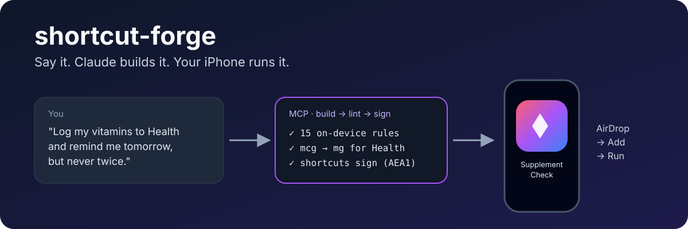

<p align="center">
  
</p>

<h1 align="center">shortcut-forge</h1>

<p align="center">
  <b>말하면 Claude가 만들고, 아이폰에서 진짜로 돌아가는 단축어.</b><br>
  MCP 서버 · Claude Code 플러그인 · Claude 데스크톱 확장 · Python DSL · iOS 27 대응
</p>

<p align="center">
  <a href="README.md">English</a> ·
  <a href="README.ko.md">한국어</a> ·
  <a href="README.ja.md">日本語</a> ·
  <a href="README.zh-CN.md">简体中文</a>
</p>

---

LLM에게 아이폰 단축어를 만들어 달라고 하면 보통 두 가지 중 하나가 나옵니다. 손으로 하나씩 눌러 넣어야 하는 단계 목록이거나, 가져오기는 되는데 폰에서 실행하는 순간 *"이 동작의 각 매개변수에 대한 값을 선택하십시오"* 로 멈추는 파일이죠.

**shortcut-forge는 그 간극을 메웁니다.** Claude가 단축어를 JSON으로 설계하면, shortcut-forge가 **실제 아이폰에서 검증된 구조만으로** `.shortcut` 파일을 만들고, 디버깅 한 바퀴씩 대가를 치르고 알아낸 14가지 실패 패턴으로 검사한 뒤, Mac으로 서명까지 해서 아이폰이 바로 가져올 수 있게 합니다.

```text
나:      "영양제 먹을 때마다 건강 앱에 기록하고, 오늘 미리알림은 완료 처리하고,
          내일 미리알림은 만들어 줘. 단 중복은 절대 안 되게."
Claude:  → shortcut_from_template("supplement-tracker", …)
         ✓ 동작 750개 · 린트 오류 0 · 서명 완료
         → ~/Downloads/shortcut-forge/Supplement Check.shortcut   (아이폰으로 AirDrop)
```

## 왜 만들었나

가족용 영양제 체크 단축어를 Claude에게 plist로 생성시켜 만들었습니다. iOS 27 저장공간, 건강 앱, 미리알림, Apple Intelligence까지 쓰는 단축어였고, 제대로 돌아가기까지 **가져오기 → 실행 → 오류 캡처를 열 번 넘게** 반복했습니다. 그 실패들은 전부 빌드할 때는 아무 문제가 없어 보였습니다.

| 이렇게 만들었더니 | 아이폰에서는 |
|---|---|
| 저장공간에 변수를 그대로 저장 | 오류 없이 **아무것도 저장 안 됨** |
| 건강 앱에 B12 "77.4 mcg" 기록 | **77,400,000 mcg**로 기록 (단위를 그램으로 읽음) |
| `만약 <사전 값> 이(가) "점심"` | 비교 칸이 비어서 실행 중단 |
| 없는 저장 키 삭제 | 오류 16 |
| 찾은 미리알림들을 완료 처리 | 실행 중에 "항목 선택" 창이 뜸 |
| 내일 미리알림 생성 | 실행할 때마다 중복 생성 |

이제 이 모든 경우를 **빌더로는 만들 수 없고, 린터는 어떤 단축어에서든 잡아냅니다.** 전체 현장 노트는 [PITFALLS.md](src/shortcut_forge/data/PITFALLS.md)에 있습니다.

## 설치

### Claude Code (플러그인: MCP + 스킬 + `/shortcut` 명령)

```bash
/plugin marketplace add Hyunki6040/shortcut-forge
/plugin install shortcut-forge@shortcut-forge
```

사용: `/shortcut-forge:shortcut 물 한 잔 기록하고 오늘 총량 알려주는 단축어`

### Claude 데스크톱

[Releases](https://github.com/Hyunki6040/shortcut-forge/releases)에서 `shortcut-forge.mcpb`를 받아 더블클릭하거나, `claude_desktop_config.json`에 추가하세요.

```json
{
  "mcpServers": {
    "shortcut-forge": {
      "command": "uvx",
      "args": ["--from", "git+https://github.com/Hyunki6040/shortcut-forge", "shortcut-forge-mcp"]
    }
  }
}
```

Mac에서는 서명까지 자동입니다. 파일은 `~/Downloads/shortcut-forge/`에 생깁니다.

### 다른 MCP 클라이언트 / 원격 커넥터

```bash
uvx --from git+https://github.com/Hyunki6040/shortcut-forge shortcut-forge-mcp          # stdio
uvx --from git+https://github.com/Hyunki6040/shortcut-forge shortcut-forge-mcp --http   # streamable HTTP
```

### Python 라이브러리 / CLI

```bash
pip install git+https://github.com/Hyunki6040/shortcut-forge
shortcut-forge template supplement-tracker --sign
shortcut-forge build examples/hello.json --sign
shortcut-forge lint "내 단축어.unsigned.shortcut"
```

## 사용법

**자연어로** (Claude 데스크톱 / Claude Code)

- "잠은 어땠는지 묻고 저장해 뒀다가, 일요일마다 Apple Intelligence가 한 주를 요약해 주는 단축어"
- "200/350/500mL 버튼으로 물 마신 걸 건강 앱에 기록하고 오늘 총량을 보여주는 단축어"
- "내가 내보낸 단축어인데 왜 멈추는지 봐 줘" → `shortcut_lint` + `shortcut_inspect`

**Python으로**: f-string 안에 변수를 그대로 넣을 수 있습니다.

```python
from shortcut_forge import Shortcut

sc = Shortcut("안녕")
name = sc.ask("이름이 뭐예요?")
with sc.if_(name, "contains", "Claude") as br:
    sc.notify("반가워요", f"또 다른 Claude군요, {name}")
    br.otherwise()
    sc.notify("안녕하세요", f"환영해요, {name}")
sc.storage_set("last_name", name)          # iOS 27 저장공간, 올바른 형식으로
sc.health_log("Vitamin D", "50")           # mcg → mg 변환 자동
sc.save("안녕.unsigned.shortcut")
```

## MCP 도구

| 도구 | 하는 일 |
|---|---|
| `shortcut_build` | JSON 스펙 → `.shortcut`, 린트는 항상, 서명은 선택 |
| `shortcut_from_template` | `supplement-tracker`, `water-log` |
| `shortcut_lint` | 서명 전 단축어 파일에 14개 규칙(SF000–SF013) 검사 |
| `shortcut_inspect` | 단축어 구조를 들여쓰기 개요로 (내보낸 파일 디버깅용) |
| `shortcut_sign` | `shortcuts sign` 래퍼, `AEA1` 헤더 확인 |
| `shortcut_reference` | spec · pitfalls · lint-rules · health-types · templates · ios27 |

## 템플릿

**supplement-tracker**: 여러 사람이 쓰는 단축어 하나로 온 가족을 관리합니다. 첫 실행 때 이 기기 사용자를 묻고, 설정은 iOS 27 저장공간에 저장되며 ⚙ 메뉴에서 바꿀 수 있습니다. 목록에 `✓ 기록함` / `▶ 지금` / `놓친 것 기록`이 표시돼서 점심 영양제를 깜빡했어도 밤에 기록할 수 있습니다. 성분별로 건강 앱에 기록하고, 오늘 그 시간대 미리알림은 완료 처리하고, **내일 미리알림은 모든 시간대에 대해 없을 때만** 만듭니다. Apple Intelligence가 쓰는 7일 리포트도 있습니다. 한국어/영어 UI.

**water-log**: 한 번 탭으로 건강 앱 기록과 오늘 총량 표시.

## iOS 27 지원 현황

| 기능 | 상태 |
|---|---|
| 저장공간 (가져오기/저장/삭제, 전역 범위) | 실기기 검증 |
| 모델 사용 (Apple Intelligence) | 실기기 검증 |
| 미리알림 찾기 / 완료 / 알림 포함 추가 | 실기기 검증 |
| 건강 샘플 기록 (영양 성분) | 실기기 검증 |
| 건강 샘플 기록 (물, 신체 지표) | 구조만 구현, 제보 환영 |

## 기여

가장 값진 기여는 **새로운 함정**입니다. 가져오기는 되는데 기기에서 실패하는 단축어를 찾으면 오류 캡처와 재현되는 가장 작은 스펙을 이슈로 올려 주세요. 린트 규칙과 빌더 수정으로 바꿔 넣겠습니다. "구조만 구현" 기능의 실기기 결과도 환영합니다.

## 라이선스

MIT. Apple, Anthropic과 관계없는 개인 프로젝트입니다. "단축어(Shortcuts)"는 Apple Inc.의 상표입니다.

스크린샷 한 바퀴라도 아껴 드렸다면 ⭐ 하나가 다른 사람이 이 프로젝트를 찾는 데 도움이 됩니다.
